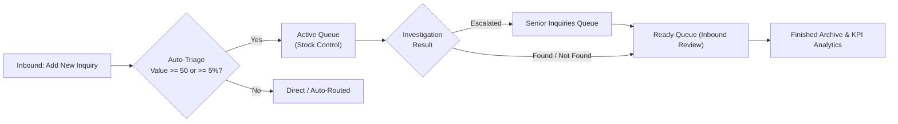

# OrderManagerPro

**Warehouse Order Discrepancy, Stock Control Investigation & Analytics Suite**  
*Developed by [Biohazard Corp](https://biohazard-corp.nl) ([@Creator-NL](https://github.com/Creator-NL))*

[](LICENSE)
[](#getting-started--building-from-source)
[](#getting-started--building-from-source)
[](#database-setup)

---

## Overview

**OrderManagerPro** is a native Windows desktop application built for warehouse, inbound logistics, and stock control teams to register, triage, investigate, and analyze order/delivery discrepancies in real time.

Instead of tracking missing items, supplier shortages, or warehouse picking/receiving errors across scattered spreadsheets and emails, **OrderManagerPro** connects **Inbound**, **Stock Control**, and **Management** in a unified SQL-backed workflow — complete with automated financial threshold triage, linked-order detection, multi-language UI (`EN` / `NL` / `DE`), and executive KPI dashboards.

---

## Key Features

### 1. Automated Inbound Triage & Threshold Routing (`DB_AddNewInquiry`)
- **Automatic Value & Percentage Evaluation:** As Inbound staff enter `Order Amount`, `Product Price`, and `Problem Amount`, **OrderManagerPro** automatically calculates both the financial value of the discrepancy (`ProblemAmount × ProductPrice`) and the discrepancy percentage (`ProblemAmount / OrderAmount × 100`):
  - **Low-Threshold Discrepancies (`< 50` currency units AND `< 5%` of order quantity):** Automatically routed to direct resolution without tying up stock investigators.
  - **High-Threshold Discrepancies (`≥ 50` currency units OR `≥ 5%` of order quantity):** Automatically routed to active Stock Control investigation (`Active`).
- **Two-Step Form Verification (`Check` → `Add`):** Validates all required fields (`Supplier`, `Order Number`, `Delivery Number`, `Product Number`, `Order Amount`, `Product Price`, `Problem Type`, `Problem Amount`, `Creator`) and locks inputs for review before database insertion.

### 2. Stock Control Investigation & Linked-Order Detection (`DB_ViewActiveInquiries`, `DB_ViewActiveInquiry`)
- **Live Queue Color Coding & Collision Prevention:**
  - **Orange Status Indicator:** Alerts Stock Control staff when an inquiry is already being investigated by a colleague (`InvestigatedBy`).
  - **Red Status Indicator:** Flags complex cases escalated for **Senior Approval** (`DB_ViewSeniorInquiries`).
- **Automatic Linked-Inquiry Discovery (`DB_FoundInquiryLinks`):** When opening an active inquiry, the system automatically checks the database for any other inquiries sharing the same `OrderNumber` and surfaces a **Found Inquiry Links** button so investigators immediately see related multi-line issues.
- **Structured Root-Cause Recording:** Tracks `InquiryResult` (`Found`, `Not Found`, `Senior Approval`), `MistakeType`, `AmountFound`, `FoundLocation`, `FoundHandlingUnit`, `MistakeMadeBy`, `InvestigatedBy`, and `InvestigatorComment`.

### 3. End-to-End Inquiry Lifecycle (`Active` → `Ready` → `Finished`)


### 4. Executive Analytics & SLA Time Tracking (`Analyzing/`)
- **Main Dashboard (`MainWindow`):** Displays a 14-day trend chart of `Inquiries`, `Found`, and `Not Found` items alongside live summary counters and overall recovery rate (`% Found`).
- **Analyzing Dashboard (`AnalyzingDashBoard`):** 4-panel analytics view with custom date-range filtering:
  - **Total Inquiries Pie Chart**
  - **Mistakes Made By (`DB_MistakesMadeBy`):** Identifies recurring error patterns by operator or station.
  - **Mistakes By Type (`DB_MistakesByType`):** Breaks down discrepancies by error category.
  - **Resolution Time Tracking (`TimeTracking`):** Calculates turnaround time in hours between inquiry creation (`DateAndTimeCreated`) and investigation completion (`DateAndTimeReady`).

### 5. Role-Based Access Control (RBAC) & Multi-Language UI
- **SHA-256 Password Authentication (`Login.cs`):** Assigns users to tailored permission groups:
  - **`Inbound`**: Add new inquiries, search inquiries, process `Ready` inquiries, and view `Finished` inquiries.
  - **`Stock Control`**: Investigate `Active` inquiries, review `Senior Approval` inquiries, and browse `Finished` inquiries.
  - **`Admin`**: Full access to Inbound, Stock Control, Analytics Dashboards, User Management (`DB_Users`), and Database Settings (`DB_DataBaseSettings`).
  - **`Super Admin`**: System-level administration console (`SuperAdmin`) for database path configuration, clipboard TSV/Excel batch import, and user provisioning.
- **Instant Trilingual Localization (`EN` / `NL` / `DE`):** Switch the UI on the fly between **English**, **Dutch (Nederlands)**, and **German (Deutsch)**, or assign a default language per user account.

---

## Project Structure

```text
OrderManagerPro/
├── database/
│   └── schema.sql                       # SQL Server LocalDB schema & seed accounts
├── OrderManagerPro/
│   ├── Analyzing/
│   │   ├── AnalyzingDashBoard.cs        # Multi-chart executive analytics dashboard
│   │   ├── DB_MistakesByType.cs         # Discrepancy breakdown by mistake category
│   │   ├── DB_MistakesMadeBy.cs         # Discrepancy breakdown by operator/source
│   │   └── TimeTracking.cs              # Inquiry turnaround SLA tracking (hours)
│   ├── Home/
│   │   └── MainWindow.cs                # Role-aware main dashboard & 14-day KPI chart
│   ├── Inquiries/
│   │   ├── DB_AddNewInquiry.cs          # Inbound registration & automatic threshold triage
│   │   ├── DB_FoundInquiryLinks.cs      # Linked inquiries sharing the same OrderNumber
│   │   ├── DB_SearchInquiries.cs        # Multi-criteria inquiry search & filter
│   │   ├── DB_ViewActiveInquiries.cs    # Stock Control queue with status color-coding
│   │   ├── DB_ViewActiveInquiry.cs      # Investigation workspace & root-cause logging
│   │   ├── DB_ViewFinishedInquiries.cs  # Completed inquiries archive
│   │   ├── DB_ViewReadyInquiries.cs     # Investigated inquiries awaiting Inbound closure
│   │   ├── DB_ViewReadyInquiry.cs       # Inbound final review & state transition to Finished
│   │   ├── DB_ViewSeniorInquiries.cs    # Escalated inquiries awaiting Senior Approval
│   │   └── ViewFoundInquiry.cs          # Read-only detail view for searched/finished items
│   ├── Settings/
│   │   ├── DB_AddNewUser.cs             # User creation with SHA-256 password hashing
│   │   ├── DB_DataBaseSettings.cs       # Database path configuration & clipboard import
│   │   ├── DB_EditUser.cs               # User directory & role management
│   │   ├── DB_Users.cs                  # User management hub
│   │   └── SuperAdmin.cs                # Super Admin system setup panel
│   ├── Login.cs                         # Authentication & role-based routing
│   └── Program.cs                       # Application entry point
└── OrderManagerPro.sln                  # Visual Studio Solution
```

---

## Database Setup

By default, **OrderManagerPro** connects to a local SQL Server Express LocalDB file at:
```text
C:\DataBase\DatabaseOrderManagerPro.mdf
```

### Quick LocalDB Initialization
1. Ensure **SQL Server Express LocalDB** is installed (included with Visual Studio's **Data storage and processing** workload).
2. Create the folder `C:\DataBase\`.
3. Create a LocalDB database file named `C:\DataBase\DatabaseOrderManagerPro.mdf` and execute [`database/schema.sql`](database/schema.sql) to create the `Users` and `OrderProblems` tables along with optional demo accounts:
   - `admin` / Password: `1` (Role: `Admin`)
   - `inbound` / Password: `1` (Role: `Inbound`)
   - `stockcontrol` / Password: `1` (Role: `Stock Control`)

---

## Getting Started & Building from Source

### Prerequisites
- Windows 10 or Windows 11
- [Visual Studio 2022](https://visualstudio.microsoft.com/) (with **.NET desktop development** workload)
- .NET Framework 4.8
- SQL Server Express LocalDB (`(LocalDB)\MSSQLLocalDB`)

### Clone & Compile
```powershell
git clone https://github.com/Creator-NL/OrderManagerPro.git
cd OrderManagerPro
```
1. Open `OrderManagerPro.sln` in Visual Studio 2022.
2. Build and run (`F5` or **Build > Build Solution**).

---

## Official Links & Support

- **Official Website:** [https://biohazard-corp.nl](https://biohazard-corp.nl)
- **GitHub Profile:** [@Creator-NL](https://github.com/Creator-NL)
- **Sponsor / Donate:** [PayPal (@biohazardcorp)](https://paypal.me/biohazardcorp)
- **Contact:** `contact@biohazard-corp.nl`

---

## License

Distributed under the **MIT License**. See [`LICENSE`](LICENSE) for full details.
